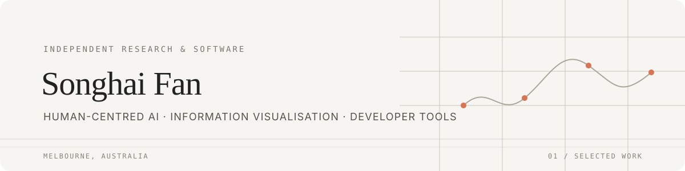

  

  <a href="https://songhai.site">Website</a> · Melbourne, Australia

I turn research ideas into tools people can use.

My work sits across **human–AI interaction**, **information visualisation**, and **developer tools**. I like making complex systems easier to understand, explore, and work with.

## Selected work

### Tools & visualisation

| Project | What it does |
| --- | --- |
| [LeftOpen](https://github.com/SonghaiFan/leftopen) | A native macOS app and CLI to see what is listening on localhost, identify the project behind it, and close it safely. · [Website](https://leftopen.songhai.site/) |
| [VisDelta](https://github.com/SonghaiFan/visdelta) | A declarative library for describing chart changes and exploring their transitions forward, backward, or by seeking to a frame. · [Docs & playground](https://songhaifan.github.io/visdelta/) |
| [Token Flow](https://github.com/SonghaiFan/token-flow) | A local-first viewer that turns AI-agent traces into conversations, token flows, and inspectable request evidence. |

### Interactive products

| Project | What it does |
| --- | --- |
| [Frankie Poker](https://github.com/SonghaiFan/frankie-poker) | An open-source Texas Hold’em playground for experimenting with how language models make decisions. |
| [Frankie Tarot](https://github.com/SonghaiFan/frankie-tarot) | A bilingual tarot experience built around user-led card reveals and reflective readings. · [Try it](https://tarot.songhai.site/) |

## Research & writing

Narrative visualisation · Human–AI interaction · Interactive systems

More about my work at [songhai.site](https://songhai.site).

---

Research into tools, and tools that invite people to think.

